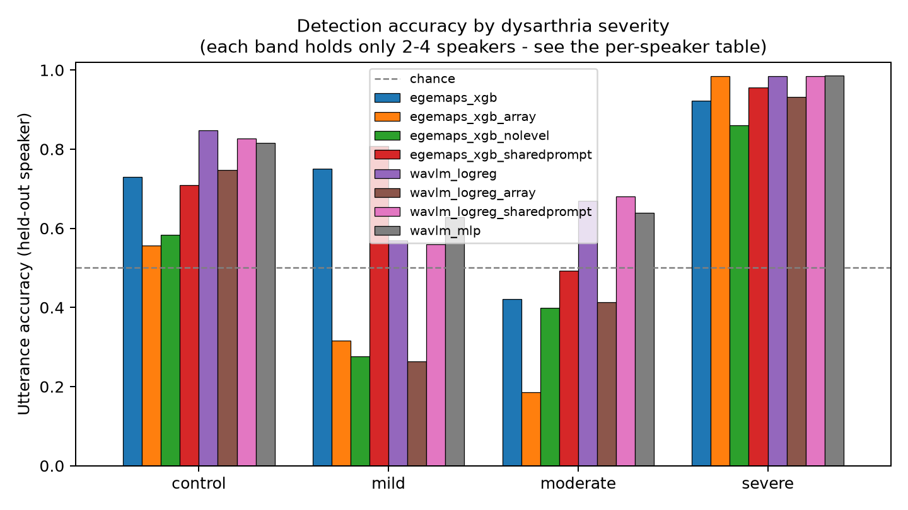
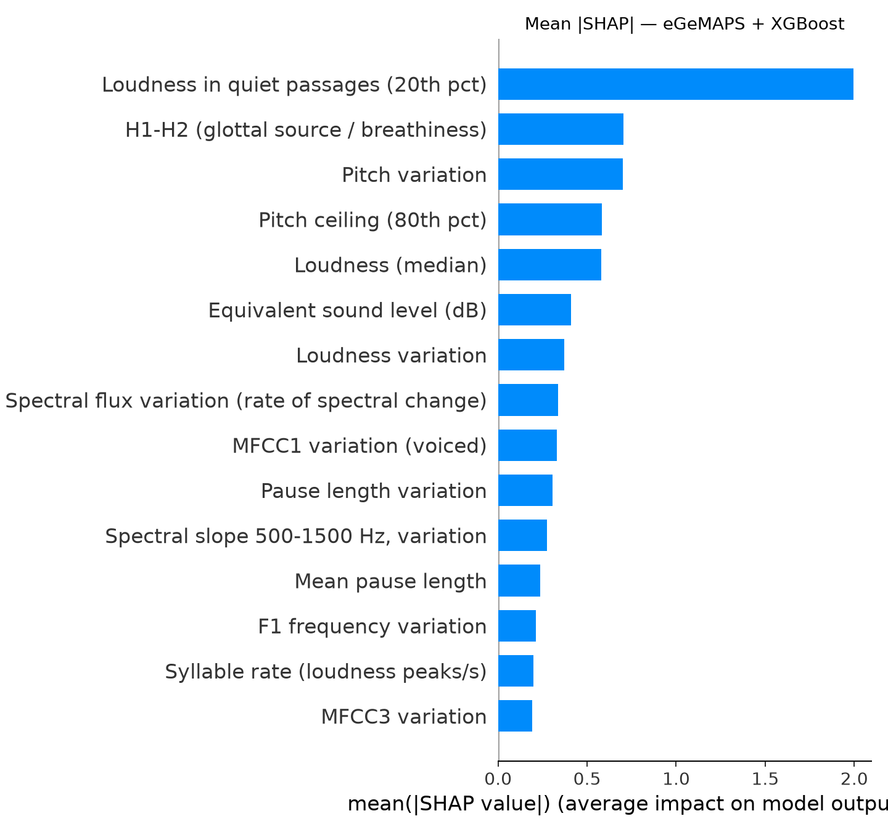
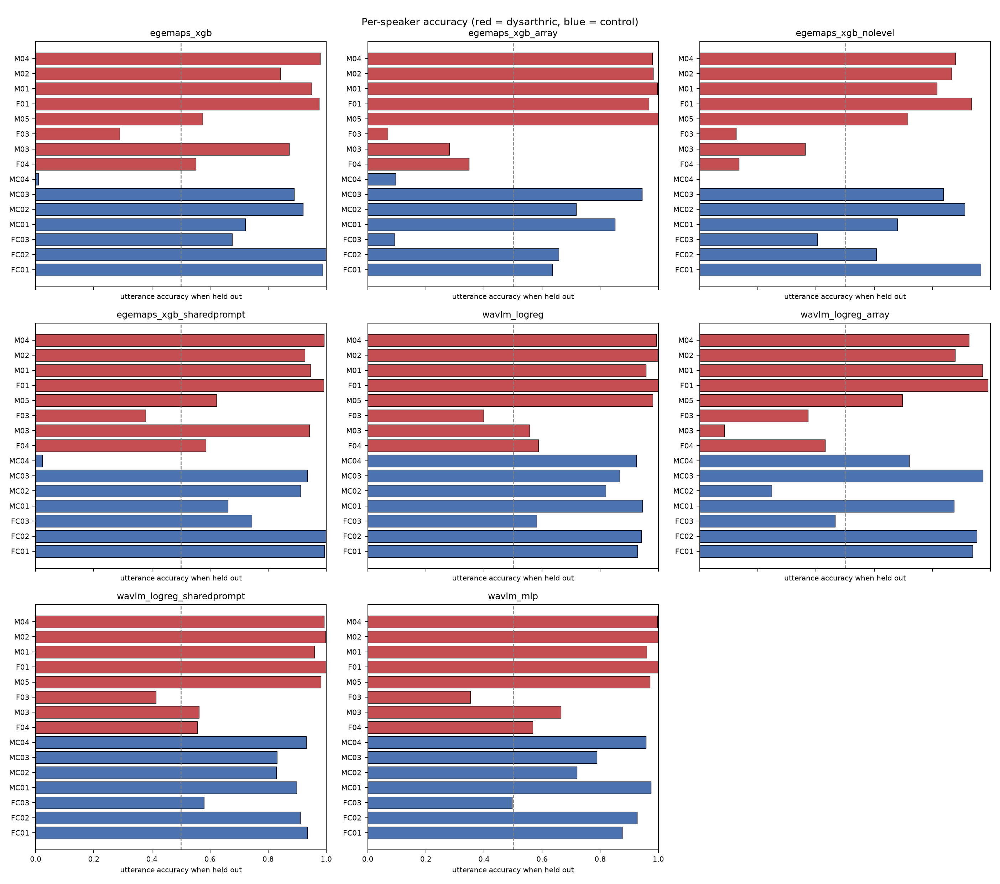

# Results

_Generated 2026-09-20 by `src/make_report.py`._

All numbers are **leave-one-speaker-out** over the 15 TORGO speakers: every fold trains on 14 speakers and tests on the held-out 15th.

## Corpus after filtering

| mic   |   speakers |   utterances |   hours |
|:------|-----------:|-------------:|--------:|
| array |         15 |         9173 |    7.67 |
| head  |         15 |         7945 |    6.62 |

Total utterances kept: **17118** of 17633 (15 speakers).

An utterance is dropped only when its prompt is explicitly an instruction rather than speech (e.g. *[relax your mouth]*) or its duration is implausible. A missing prompt transcript is a gap in TORGO's metadata, not evidence that a recording is unusable, so it is **not** a reason to drop by default. Any filter that removed much more of one group than the other would itself be a confound, so the rates are reported here (only the middle column affects `keep`):

| group      |   no_prompt |   instruction_prompt |   too_short_or_long |
|:-----------|------------:|---------------------:|--------------------:|
| control    |       0.008 |                0.022 |               0     |
| dysarthric |       0.046 |                0.036 |               0.007 |

## Model comparison

| name                      | model   | mic   |   n_features |   n_utts |   utt_accuracy |   utt_balanced_accuracy |   utt_f1 |   utt_auc |   utt_sensitivity |   utt_specificity | speaker_correct   |
|:--------------------------|:--------|:------|-------------:|---------:|---------------:|------------------------:|---------:|----------:|------------------:|------------------:|:------------------|
| egemaps_xgb               | xgb     | head  |           88 |     7945 |         0.7201 |                  0.7163 |   0.6429 |    0.765  |            0.7029 |            0.7296 | 13/15             |
| egemaps_xgb_array         | xgb     | array |           88 |     9171 |         0.5564 |                  0.5563 |   0.4557 |    0.5898 |            0.5558 |            0.5567 | 10/15             |
| egemaps_xgb_nolevel       | xgb     | head  |           82 |     7945 |         0.5748 |                  0.5717 |   0.486  |    0.589  |            0.5607 |            0.5827 | 10/15             |
| egemaps_xgb_sharedprompt  | xgb     | head  |           88 |     6407 |         0.7292 |                  0.7323 |   0.7079 |    0.7714 |            0.7556 |            0.709  | 13/15             |
| wavlm_logreg              | logreg  | head  |         1536 |     7945 |         0.822  |                  0.8117 |   0.7575 |    0.8826 |            0.7753 |            0.8481 | 14/15             |
| wavlm_logreg_array        | logreg  | array |         1536 |     9173 |         0.6946 |                  0.6685 |   0.5634 |    0.7287 |            0.5896 |            0.7474 | 10/15             |
| wavlm_logreg_sharedprompt | logreg  | head  |         1536 |     6407 |         0.8052 |                  0.802  |   0.7761 |    0.8747 |            0.7775 |            0.8265 | 14/15             |
| wavlm_mlp                 | mlp     | head  |         1536 |     7945 |         0.8033 |                  0.798  |   0.7396 |    0.8701 |            0.7795 |            0.8166 | 13/15             |

`speaker_correct` counts speakers classified correctly by the mean probability over all their utterances — the number that matters for a screening tool, which sees a person, not an utterance.

## Accuracy by severity

| run                       | severity   |   speakers |   utts |   utt_acc | speakers_correct   |
|:--------------------------|:-----------|-----------:|-------:|----------:|:-------------------|
| egemaps_xgb               | control    |          7 |   5097 |    0.7296 | 6/7                |
| egemaps_xgb               | mild       |          2 |    651 |    0.7512 | 2/2                |
| egemaps_xgb               | moderate   |          2 |   1026 |    0.4211 | 1/2                |
| egemaps_xgb               | severe     |          4 |   1171 |    0.9231 | 4/4                |
| egemaps_xgb_array         | control    |          7 |   6107 |    0.5567 | 5/7                |
| egemaps_xgb_array         | mild       |          2 |    838 |    0.3162 | 0/2                |
| egemaps_xgb_array         | moderate   |          2 |    944 |    0.1864 | 1/2                |
| egemaps_xgb_array         | severe     |          4 |   1282 |    0.9844 | 4/4                |
| egemaps_xgb_nolevel       | control    |          7 |   5097 |    0.5827 | 5/7                |
| egemaps_xgb_nolevel       | mild       |          2 |    651 |    0.2765 | 0/2                |
| egemaps_xgb_nolevel       | moderate   |          2 |   1026 |    0.3986 | 1/2                |
| egemaps_xgb_nolevel       | severe     |          4 |   1171 |    0.8608 | 4/4                |
| egemaps_xgb_sharedprompt  | control    |          7 |   3625 |    0.709  | 6/7                |
| egemaps_xgb_sharedprompt  | mild       |          2 |    641 |    0.8081 | 2/2                |
| egemaps_xgb_sharedprompt  | moderate   |          2 |    998 |    0.493  | 1/2                |
| egemaps_xgb_sharedprompt  | severe     |          4 |   1143 |    0.9554 | 4/4                |
| wavlm_logreg              | control    |          7 |   5097 |    0.8481 | 7/7                |
| wavlm_logreg              | mild       |          2 |    651 |    0.5684 | 2/2                |
| wavlm_logreg              | moderate   |          2 |   1026 |    0.6686 | 1/2                |
| wavlm_logreg              | severe     |          4 |   1171 |    0.9838 | 4/4                |
| wavlm_logreg_array        | control    |          7 |   6108 |    0.7474 | 5/7                |
| wavlm_logreg_array        | mild       |          2 |    838 |    0.2637 | 0/2                |
| wavlm_logreg_array        | moderate   |          2 |    944 |    0.4131 | 1/2                |
| wavlm_logreg_array        | severe     |          4 |   1283 |    0.9322 | 4/4                |
| wavlm_logreg_sharedprompt | control    |          7 |   3625 |    0.8265 | 7/7                |
| wavlm_logreg_sharedprompt | mild       |          2 |    641 |    0.5601 | 2/2                |
| wavlm_logreg_sharedprompt | moderate   |          2 |    998 |    0.6804 | 1/2                |
| wavlm_logreg_sharedprompt | severe     |          4 |   1143 |    0.9843 | 4/4                |
| wavlm_mlp                 | control    |          7 |   5097 |    0.8166 | 6/7                |
| wavlm_mlp                 | mild       |          2 |    651 |    0.6283 | 2/2                |
| wavlm_mlp                 | moderate   |          2 |   1026 |    0.6394 | 1/2                |
| wavlm_mlp                 | severe     |          4 |   1171 |    0.9863 | 4/4                |

Mild dysarthria is the hard case, and it is the case that matters most for early screening: by the time a speaker is severe, detection is not the clinical question. A single pooled accuracy figure hides this.

## The microphone confound

| experiment               |   utt_accuracy |   utt_auc |   speaker_accuracy |
|:-------------------------|---------------:|----------:|-------------------:|
| A_matched_head           |         0.7201 |    0.765  |             0.8667 |
| A_matched_array          |         0.5564 |    0.5898 |             0.6667 |
| B_mismatch_head_to_array |         0.2328 |    0.135  |             0.4    |
| B_mismatch_array_to_head |         0.2532 |    0.2829 |             0.2    |
| C_channel_probe          |         0.995  |    0.9999 |                    |
| D_confounded_dys_head    |         0.9678 |    0.9991 |             1      |
| D_confounded_dys_array   |         0.9925 |    0.9998 |             1      |

**How to read this.** `A_matched` is the honest protocol. `C_channel_probe` shows the microphone is almost perfectly recoverable from the same eGeMAPS features the detector uses. `D_confounded_*` aligns microphone with group on purpose and produces the highest accuracy in this repository — a microphone detector, not a dysarthria detector. `B_mismatch_*` shows how little of the matched model transfers when only the channel changes.

This is why every headline result here fixes the microphone to the head-mounted channel for **both** groups.

## What the model listens to (SHAP, held-out utterances)

| acoustic parameter                                |   mean |SHAP| |
|:--------------------------------------------------|--------------:|
| Loudness in quiet passages (20th pct)             |        1.9961 |
| H1-H2 (glottal source / breathiness)              |        0.7034 |
| Pitch variation                                   |        0.7019 |
| Pitch ceiling (80th pct)                          |        0.5834 |
| Loudness (median)                                 |        0.5808 |
| Equivalent sound level (dB)                       |        0.4097 |
| Loudness variation                                |        0.3713 |
| Spectral flux variation (rate of spectral change) |        0.3372 |
| MFCC1 variation (voiced)                          |        0.3286 |
| Pause length variation                            |        0.3074 |
| Spectral slope 500-1500 Hz, variation             |        0.2759 |
| Mean pause length                                 |        0.2371 |
| F1 frequency variation                            |        0.2124 |
| Syllable rate (loudness peaks/s)                  |        0.1983 |
| MFCC3 variation                                   |        0.1911 |

These are computed only on held-out speakers, so they describe out-of-sample behaviour rather than what the model memorised.

## Per-speaker detail — `egemaps_xgb`

| speaker   | group      | severity   |   n_utts |   utt_acc |   mean_prob |   spk_correct |
|:----------|:-----------|:-----------|---------:|----------:|------------:|--------------:|
| FC01      | control    | control    |      153 |     0.987 |       0.029 |             1 |
| FC02      | control    | control    |      979 |     1     |       0.031 |             1 |
| FC03      | control    | control    |      975 |     0.676 |       0.361 |             1 |
| MC01      | control    | control    |     1091 |     0.721 |       0.294 |             1 |
| MC02      | control    | control    |      453 |     0.921 |       0.116 |             1 |
| MC03      | control    | control    |      809 |     0.89  |       0.152 |             1 |
| MC04      | control    | control    |      637 |     0.009 |       0.958 |             0 |
| F04       | dysarthric | mild       |      245 |     0.551 |       0.53  |             1 |
| M03       | dysarthric | mild       |      406 |     0.872 |       0.838 |             1 |
| F03       | dysarthric | moderate   |      551 |     0.289 |       0.321 |             0 |
| M05       | dysarthric | moderate   |      475 |     0.575 |       0.598 |             1 |
| F01       | dysarthric | severe     |      123 |     0.976 |       0.812 |             1 |
| M01       | dysarthric | severe     |      375 |     0.949 |       0.925 |             1 |
| M02       | dysarthric | severe     |      391 |     0.841 |       0.836 |             1 |
| M04       | dysarthric | severe     |      282 |     0.979 |       0.953 |             1 |

## Per-speaker detail — `egemaps_xgb_array`

| speaker   | group      | severity   |   n_utts |   utt_acc |   mean_prob |   spk_correct |
|:----------|:-----------|:-----------|---------:|----------:|------------:|--------------:|
| FC01      | control    | control    |      244 |     0.635 |       0.393 |             1 |
| FC02      | control    | control    |     1236 |     0.657 |       0.395 |             1 |
| FC03      | control    | control    |      971 |     0.093 |       0.863 |             0 |
| MC01      | control    | control    |     1091 |     0.851 |       0.195 |             1 |
| MC02      | control    | control    |      682 |     0.717 |       0.303 |             1 |
| MC03      | control    | control    |      879 |     0.944 |       0.091 |             1 |
| MC04      | control    | control    |     1004 |     0.096 |       0.81  |             0 |
| F04       | dysarthric | mild       |      433 |     0.349 |       0.395 |             0 |
| M03       | dysarthric | mild       |      405 |     0.281 |       0.309 |             0 |
| F03       | dysarthric | moderate   |      825 |     0.069 |       0.094 |             0 |
| M05       | dysarthric | moderate   |      119 |     1     |       0.995 |             1 |
| F01       | dysarthric | severe     |      123 |     0.967 |       0.906 |             1 |
| M01       | dysarthric | severe     |      376 |     0.997 |       0.994 |             1 |
| M02       | dysarthric | severe     |      387 |     0.982 |       0.958 |             1 |
| M04       | dysarthric | severe     |      396 |     0.98  |       0.968 |             1 |

## Per-speaker detail — `egemaps_xgb_nolevel`

| speaker   | group      | severity   |   n_utts |   utt_acc |   mean_prob |   spk_correct |
|:----------|:-----------|:-----------|---------:|----------:|------------:|--------------:|
| FC01      | control    | control    |      153 |     0.967 |       0.075 |             1 |
| FC02      | control    | control    |      979 |     0.608 |       0.403 |             1 |
| FC03      | control    | control    |      975 |     0.404 |       0.583 |             0 |
| MC01      | control    | control    |     1091 |     0.68  |       0.322 |             1 |
| MC02      | control    | control    |      453 |     0.912 |       0.125 |             1 |
| MC03      | control    | control    |      809 |     0.838 |       0.215 |             1 |
| MC04      | control    | control    |      637 |     0     |       0.988 |             0 |
| F04       | dysarthric | mild       |      245 |     0.135 |       0.194 |             0 |
| M03       | dysarthric | mild       |      406 |     0.362 |       0.375 |             0 |
| F03       | dysarthric | moderate   |      551 |     0.125 |       0.204 |             0 |
| M05       | dysarthric | moderate   |      475 |     0.716 |       0.696 |             1 |
| F01       | dysarthric | severe     |      123 |     0.935 |       0.761 |             1 |
| M01       | dysarthric | severe     |      375 |     0.816 |       0.802 |             1 |
| M02       | dysarthric | severe     |      391 |     0.867 |       0.826 |             1 |
| M04       | dysarthric | severe     |      282 |     0.879 |       0.779 |             1 |

## Per-speaker detail — `egemaps_xgb_sharedprompt`

| speaker   | group      | severity   |   n_utts |   utt_acc |   mean_prob |   spk_correct |
|:----------|:-----------|:-----------|---------:|----------:|------------:|--------------:|
| FC01      | control    | control    |      153 |     0.993 |       0.023 |             1 |
| FC02      | control    | control    |      454 |     1     |       0.031 |             1 |
| FC03      | control    | control    |      677 |     0.743 |       0.313 |             1 |
| MC01      | control    | control    |      683 |     0.662 |       0.354 |             1 |
| MC02      | control    | control    |      449 |     0.911 |       0.115 |             1 |
| MC03      | control    | control    |      628 |     0.935 |       0.104 |             1 |
| MC04      | control    | control    |      581 |     0.022 |       0.952 |             0 |
| F04       | dysarthric | mild       |      241 |     0.585 |       0.539 |             1 |
| M03       | dysarthric | mild       |      400 |     0.942 |       0.895 |             1 |
| F03       | dysarthric | moderate   |      529 |     0.378 |       0.389 |             0 |
| M05       | dysarthric | moderate   |      469 |     0.623 |       0.636 |             1 |
| F01       | dysarthric | severe     |      113 |     0.991 |       0.816 |             1 |
| M01       | dysarthric | severe     |      369 |     0.946 |       0.928 |             1 |
| M02       | dysarthric | severe     |      382 |     0.927 |       0.891 |             1 |
| M04       | dysarthric | severe     |      279 |     0.993 |       0.965 |             1 |

## Per-speaker detail — `wavlm_logreg`

| speaker   | group      | severity   |   n_utts |   utt_acc |   mean_prob |   spk_correct |
|:----------|:-----------|:-----------|---------:|----------:|------------:|--------------:|
| FC01      | control    | control    |      153 |     0.928 |       0.123 |             1 |
| FC02      | control    | control    |      979 |     0.942 |       0.096 |             1 |
| FC03      | control    | control    |      975 |     0.582 |       0.438 |             1 |
| MC01      | control    | control    |     1091 |     0.945 |       0.084 |             1 |
| MC02      | control    | control    |      453 |     0.819 |       0.223 |             1 |
| MC03      | control    | control    |      809 |     0.867 |       0.146 |             1 |
| MC04      | control    | control    |      637 |     0.925 |       0.102 |             1 |
| F04       | dysarthric | mild       |      245 |     0.588 |       0.567 |             1 |
| M03       | dysarthric | mild       |      406 |     0.557 |       0.559 |             1 |
| F03       | dysarthric | moderate   |      551 |     0.399 |       0.405 |             0 |
| M05       | dysarthric | moderate   |      475 |     0.981 |       0.976 |             1 |
| F01       | dysarthric | severe     |      123 |     1     |       0.999 |             1 |
| M01       | dysarthric | severe     |      375 |     0.957 |       0.957 |             1 |
| M02       | dysarthric | severe     |      391 |     0.997 |       0.996 |             1 |
| M04       | dysarthric | severe     |      282 |     0.993 |       0.989 |             1 |

## Per-speaker detail — `wavlm_logreg_array`

| speaker   | group      | severity   |   n_utts |   utt_acc |   mean_prob |   spk_correct |
|:----------|:-----------|:-----------|---------:|----------:|------------:|--------------:|
| FC01      | control    | control    |      244 |     0.939 |       0.104 |             1 |
| FC02      | control    | control    |     1236 |     0.954 |       0.085 |             1 |
| FC03      | control    | control    |      972 |     0.466 |       0.541 |             0 |
| MC01      | control    | control    |     1091 |     0.875 |       0.169 |             1 |
| MC02      | control    | control    |      682 |     0.248 |       0.713 |             0 |
| MC03      | control    | control    |      879 |     0.974 |       0.038 |             1 |
| MC04      | control    | control    |     1004 |     0.721 |       0.31  |             1 |
| F04       | dysarthric | mild       |      433 |     0.432 |       0.447 |             0 |
| M03       | dysarthric | mild       |      405 |     0.084 |       0.126 |             0 |
| F03       | dysarthric | moderate   |      825 |     0.372 |       0.384 |             0 |
| M05       | dysarthric | moderate   |      119 |     0.697 |       0.681 |             1 |
| F01       | dysarthric | severe     |      123 |     0.992 |       0.992 |             1 |
| M01       | dysarthric | severe     |      376 |     0.973 |       0.963 |             1 |
| M02       | dysarthric | severe     |      387 |     0.879 |       0.871 |             1 |
| M04       | dysarthric | severe     |      397 |     0.927 |       0.914 |             1 |

## Per-speaker detail — `wavlm_logreg_sharedprompt`

| speaker   | group      | severity   |   n_utts |   utt_acc |   mean_prob |   spk_correct |
|:----------|:-----------|:-----------|---------:|----------:|------------:|--------------:|
| FC01      | control    | control    |      153 |     0.935 |       0.117 |             1 |
| FC02      | control    | control    |      454 |     0.91  |       0.131 |             1 |
| FC03      | control    | control    |      677 |     0.579 |       0.448 |             1 |
| MC01      | control    | control    |      683 |     0.898 |       0.125 |             1 |
| MC02      | control    | control    |      449 |     0.829 |       0.206 |             1 |
| MC03      | control    | control    |      628 |     0.831 |       0.175 |             1 |
| MC04      | control    | control    |      581 |     0.931 |       0.105 |             1 |
| F04       | dysarthric | mild       |      241 |     0.556 |       0.55  |             1 |
| M03       | dysarthric | mild       |      400 |     0.562 |       0.567 |             1 |
| F03       | dysarthric | moderate   |      529 |     0.414 |       0.414 |             0 |
| M05       | dysarthric | moderate   |      469 |     0.981 |       0.973 |             1 |
| F01       | dysarthric | severe     |      113 |     1     |       1     |             1 |
| M01       | dysarthric | severe     |      369 |     0.959 |       0.955 |             1 |
| M02       | dysarthric | severe     |      382 |     0.997 |       0.997 |             1 |
| M04       | dysarthric | severe     |      279 |     0.993 |       0.988 |             1 |

## Per-speaker detail — `wavlm_mlp`

| speaker   | group      | severity   |   n_utts |   utt_acc |   mean_prob |   spk_correct |
|:----------|:-----------|:-----------|---------:|----------:|------------:|--------------:|
| FC01      | control    | control    |      153 |     0.876 |       0.145 |             1 |
| FC02      | control    | control    |      979 |     0.926 |       0.102 |             1 |
| FC03      | control    | control    |      975 |     0.496 |       0.505 |             0 |
| MC01      | control    | control    |     1091 |     0.974 |       0.038 |             1 |
| MC02      | control    | control    |      453 |     0.72  |       0.298 |             1 |
| MC03      | control    | control    |      809 |     0.789 |       0.223 |             1 |
| MC04      | control    | control    |      637 |     0.958 |       0.049 |             1 |
| F04       | dysarthric | mild       |      245 |     0.567 |       0.548 |             1 |
| M03       | dysarthric | mild       |      406 |     0.665 |       0.664 |             1 |
| F03       | dysarthric | moderate   |      551 |     0.354 |       0.356 |             0 |
| M05       | dysarthric | moderate   |      475 |     0.971 |       0.975 |             1 |
| F01       | dysarthric | severe     |      123 |     1     |       0.998 |             1 |
| M01       | dysarthric | severe     |      375 |     0.96  |       0.956 |             1 |
| M02       | dysarthric | severe     |      391 |     1     |       0.999 |             1 |
| M04       | dysarthric | severe     |      282 |     0.996 |       0.992 |             1 |

---

TORGO is used under its academic licence; see README for the required citation. This is a research prototype, not a medical device.
